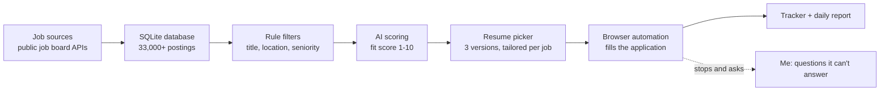

# Job Application Pipeline

A Python tool I built and run every day to run my own job search. It pulls job postings, filters and scores them, makes a resume that fits each job, and fills out the application forms. A person stays in the loop for anything it can't answer honestly.

**What this project shows:** Python, SQLite, browser automation, working with APIs, debugging logic bugs from logs and data, and building safety rules into automation.

> The code stays private because it holds my personal information (contact details, application answers). This is the write-up.

## How it works

1. **Collect.** Pulls postings from public job board APIs into SQLite and removes duplicates.
2. **Filter.** Rules drop senior roles, wrong locations and blocked companies, then sort each job into a lane (IT support, data center, remote support).
3. **Score.** An AI model scores how well each job fits on a 1 to 10 scale, and only strong matches move on.
4. **Tailor.** Picks one of three resumes (IT Support, Data Center Technician, Technical Support), reorders the projects to match the posting, and renders a one-page PDF.
5. **Apply.** Fills out the forms with Playwright across 15+ applicant tracking systems.
6. **Report.** Logs every application to a tracker and posts a daily summary.

## Safety rules I built in

- **Dry-run mode.** It fills everything but submits nothing until I check the results.
- **It stops at any CAPTCHA or "verify you're human" check** and leaves that one for me. It never tries to get around them.
- **It never makes up an answer.** If a question isn't covered by my saved answers (background questions, anything new), it stops and asks me.
- **It answers experience questions truthfully**, even when the honest answer hurts the application.
- **Daily caps and spacing**, so it doesn't flood any one site.

## Problems I troubleshot

| Symptom | What I found | Fix |
|---|---|---|
| Searches only ran on some days | A condition skipped searching whenever 5+ jobs were already queued, which was most days | Changed it so searches also run when the last search is stale |
| "Computer Technician" jobs landed in the marketing lane | The title matched a broad pattern before the tech patterns were checked | Added the missing tech titles and checked the data center and tech lanes first |
| Good support jobs got blocked | A rule blocked every title with "Engineer", including "IT Support Engineer" | Added an exception for support titles |
| Every job got the same generic resume | The resume step didn't know the job title | Built a title-to-resume map (8+ title patterns) so each job gets its own version |
| A resume spilled onto 2 pages | Long bullets plus margins | Tightened the bullets and layout and checked the page count on every build |

## Skills used

Python, SQLite, Playwright, REST APIs, regular expressions, PDF generation (ReportLab), YAML config, Windows Task Scheduler, logging, debugging with real data.

## What I'd do next

- Add tests for the lane rules so a new title pattern can't quietly break another lane
- A small dashboard for response rates by lane

---
© 2026 Goodness Onyemenam. All rights reserved. Shared to show my work, not licensed for reuse.
